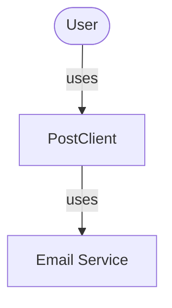
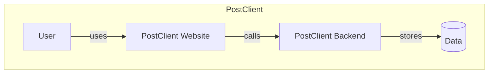
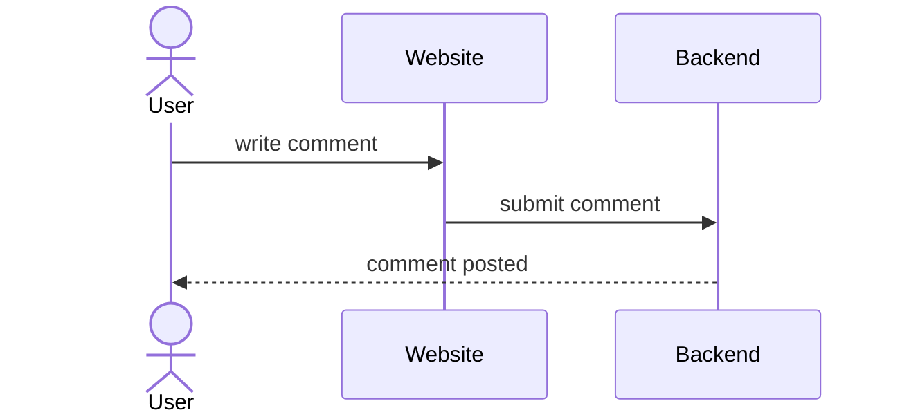

# PostClient

<!-- CI badge: after Session 4, replace ORG/REPO and the workflow filename, then uncomment:

-->

**Student:** Yousuf Habouh · **Course:** CEN 5064 Software Design, Fall 2026 · **Partner:** [@ghechavarria]

## Project (approval paragraph — write this by Sun Aug 30)

The system will implement a chatting application, which will be called PostClient. I'll make this project by implementing a backend that allows for account creation and community creation, and a frontend that showcases posts on the involved communities for a user. I am making this because one of the main reasons users use the internet is to communicate with each other, and this will offer one more avenue of communication.

Business Rules:
- A user can be the owner of 10 communities at most.
- A community needs exactly 1 owner at all time.
- A user can either upvote once, downvote once, or not vote for any single post/comment.
- Passwords need to be at least 8 characters long.

Core Features:
- A person can make an account.
- An account can make a community which they would own by default.
- Accounts can create Posts under a community.
- Accounts can post comments under a post or other comments.

## How to run

```
To run the demo of this software, you need to be on a system with Python 3.14 and the latest version of node installed.

To run the backend:
  - Go to python_backend by doing `cd python_backend`
  - Do `py -m venv venv`
  - Do `pip install -r requirements.txt`
  - Create a .env file and specify DATABASE_PATH as the path to a database.db file that will be used for sqlite connection.
  - Do `py main.py`

To run the frontend:
  - Go to react_frontend by doing `cd react_frontend`
  - Do `npm install`
  - Create a .env file and specify VITE_BACKEND_DOMAIN to connect to backend (default should be http://127.0.0.1:8000)
  - Do `npm run dev`

After running both, the link to access the service through the frontend will be shown in the powershell entry for the frontend.
```

## Architecture

### Tier breakdown (Session 2 studio)

| Tier | Responsibilities in THIS system |
|------|--------------------------------|
| Presentation | Displays Posts in a column list when checking a community with getPostList, displays comments in a column list under posts getCommentList. Will support light and dark mode with setLightMode |
| Service | create an account createAccount, create a community createCommunity, edit a comment editComment, etc |
| Domain | Accounts can only subscribe to 200 communities, can upvote once only per comment/post, a community can have 1 owner at most |
| Data | SQL tables store account information, account sign in data, a table for comments, a table for posts, a table for communities |

### C4 — Context & Container (Session 3 studio)

## 1. Context Diagram



## 2. Container Diagram



### UML — Class & Sequence (Session 3 studio)

## 3. Class Diagram

```mermaid
    %% Generated by PyUML Generator. Manual changes may be overwritten.
    classDiagram
    direction TB
    %% module: external
    namespace external {
        class C1["Exception"] {
        <<external>>
        }
        class C2["data.database.Database"] {
        <<external>>
        }
        class C3["domain.account.Account"] {
        <<external>>
        }
        class C4["domain.comment.Comment"] {
        <<external>>
        }
        class C5["domain.community.Community"] {
        <<external>>
        }
        class C6["domain.post.Post"] {
        <<external>>
        }
        class C7["pathlib.Path"] {
        <<external>>
        }
        class C8["pydantic.BaseModel"] {
        <<external>>
        }
    }
    %% module: python_backend.application.account_service
    namespace python_backend_application_account_service {
        class C9["python_backend.application.account_service.AccountService"] {
        #repository
        +init(repository)
        +create_account(username: str, password: str) dict
        +login(username: str, password: str) dict
        +get_account_id_from_token(token: str) int
        +get_account_by_token(token: str) Account
        +get_username_by_id(account_id: int) str
        +is_username_available(username: str, exclude_account_id: int_or_None) bool
        +update_username(account_id: int, new_username: str) str
        +update_password(account_id: int, current_password: str, new_password: str) None
        +find_account_by_identifier(identifier: str) Account_or_None
        +logout(token: str) None
        }
    }
    %% module: python_backend.application.comment_service
    namespace python_backend_application_comment_service {
        class C10["python_backend.application.comment_service.CommentService"] {
        #repository
        #post_repository
        #community_repository
        +init(repository, post_repository, community_repository)
        +create_comment(author_id: int, post_id: int, description: str) Comment
        +get_comment(comment_id: int) Comment
        +list_comments(post_id: int) list~Comment~
        +update_comment(comment_id: int, user_id: int, description: str) Comment
        +vote(comment_id: int, user_id: int, direction: int) dict
        +get_user_vote(comment_id: int, user_id: int) int
        +delete_comment(comment_id: int, user_id: int) None
        }
    }
    %% module: python_backend.application.community_service
    namespace python_backend_application_community_service {
        class C11["python_backend.application.community_service.CommunityService"] {
        #repository
        +init(repository)
        +create_community(owner_id: int, name: str, description: str, picture: str) Community
        +get_community(community_id: int) Community
        +list_communities() list~Community~
        +update_community(community_id: int, user_id: int, name: str, description: str, picture: str) Community
        +transfer_ownership(community_id: int, current_user_id: int, target_identifier: str, account_service) Community
        +delete_community(community_id: int, user_id: int) None
        +add_moderator(community_id: int, current_user_id: int, target_identifier: str, account_service) dict
        +remove_moderator(community_id: int, current_user_id: int, target_account_id: int) None
        +list_moderators(community_id: int, account_service) list~dict~
        +is_moderator_or_owner(community_id: int, user_id: int) bool
        +ban_user(community_id: int, current_user_id: int, target_identifier: str, account_service) dict
        +unban_user(community_id: int, current_user_id: int, target_account_id: int) None
        +list_banned(community_id: int, current_user_id: int, account_service) list~dict~
        +is_banned(community_id: int, user_id: int) bool
        }
    }
    %% module: python_backend.application.post_service
    namespace python_backend_application_post_service {
        class C12["python_backend.application.post_service.PostService"] {
        #repository
        #community_repository
        +init(repository, community_repository)
        +create_post(author_id: int, community_id: int, name: str, description: str) Post
        +get_post(post_id: int) Post
        +list_posts(community_id: int_or_None) list~Post~
        +update_post(post_id: int, user_id: int, name: str, description: str) Post
        +vote(post_id: int, user_id: int, direction: int) dict
        +get_user_vote(post_id: int, user_id: int) int
        +delete_post(post_id: int, user_id: int) None
        }
    }
    %% module: python_backend.application.report_service
    namespace python_backend_application_report_service {
        class C13["python_backend.application.report_service.ReportService"] {
        #report_repo
        #post_repo
        #comment_repo
        #comm_repo
        +init(report_repository, post_repository, comment_repository, community_repository)
        #check_moderator_or_owner(community_id: int, user_id: int) None
        +report_post(user_id: int, post_id: int) None
        +report_comment(user_id: int, comment_id: int) None
        +list_reports(community_id: int, user_id: int, account_service) list~dict~
        +approve_item(community_id: int, user_id: int, target_type: str, target_id: int) None
        +delete_reported_item(community_id: int, user_id: int, target_type: str, target_id: int) None
        }
    }
    %% module: python_backend.data.account_repository
    namespace python_backend_data_account_repository {
        class C14["python_backend.data.account_repository.SqliteAccountRepository"] {
        #db
        +init(database: Database)
        #init_tables() None
        +add(account: Account) None
        +find_by_username(username: str) Account_or_None
        +find_by_id(account_id: int) Account_or_None
        +is_username_available(username: str, exclude_account_id: int_or_None) bool
        +update_username(account_id: int, new_username: str) None
        +update_password(account_id: int, new_password_hash: str) None
        +save_token(token: str, account_id: int) None
        +find_account_id_by_token(token: str) int_or_None
        +delete_token(token: str) None
        }
    }
    %% module: python_backend.data.comment_repository
    namespace python_backend_data_comment_repository {
        class C15["python_backend.data.comment_repository.SqliteCommentRepository"] {
        #db
        +init(database: Database)
        #init_tables() None
        +add(comment: Comment) None
        +find_by_id(comment_id: int) Comment_or_None
        +list_by_post(post_id: int) list~Comment~
        +update(comment: Comment) None
        +set_approved(comment_id: int, is_approved: int) None
        +delete(comment_id: int) None
        +get_user_vote(account_id: int, comment_id: int) int
        +vote(account_id: int, comment_id: int, direction: int) tuple~int_int_int~
        }
    }
    %% module: python_backend.data.community_repository
    namespace python_backend_data_community_repository {
        class C16["python_backend.data.community_repository.SqliteCommunityRepository"] {
        #db
        +init(database: Database)
        #init_tables() None
        +add(community: Community) None
        +find_by_id(community_id: int) Community_or_None
        +list_all() list~Community~
        +count_by_owner(owner_id: int) int
        +update(community: Community) None
        +transfer_ownership(community_id: int, new_owner_id: int) None
        +delete(community_id: int) None
        +add_moderator(community_id: int, account_id: int) None
        +remove_moderator(community_id: int, account_id: int) None
        +list_moderators(community_id: int) list~int~
        +is_moderator(community_id: int, account_id: int) bool
        +ban_user(community_id: int, account_id: int, banned_by_id: int) None
        +unban_user(community_id: int, account_id: int) None
        +list_banned(community_id: int) list~dict~
        +is_banned(community_id: int, account_id: int) bool
        }
    }
    %% module: python_backend.data.database
    namespace python_backend_data_database {
        class C17["python_backend.data.database.Database"] {
        #Path path
        +init(path: str)
        +connect()
        +ensure_table(create_sql: str) None
        }
    }
    %% module: python_backend.data.post_repository
    namespace python_backend_data_post_repository {
        class C18["python_backend.data.post_repository.SqlitePostRepository"] {
        #db
        +init(database: Database)
        #init_tables() None
        +add(post: Post) None
        +find_by_id(post_id: int) Post_or_None
        +list_by_community(community_id: int) list~Post~
        +list_all() list~Post~
        +update(post: Post) None
        +set_approved(post_id: int, is_approved: int) None
        +delete(post_id: int) None
        +get_user_vote(account_id: int, post_id: int) int
        +vote(account_id: int, post_id: int, direction: int) tuple~int_int_int~
        }
    }
    %% module: python_backend.data.report_repository
    namespace python_backend_data_report_repository {
        class C19["python_backend.data.report_repository.SqliteReportRepository"] {
        #db
        +init(database: Database)
        #init_tables() None
        +add_report(community_id: int, target_type: str, target_id: int, reporter_id: int) int
        +has_user_reported(target_type: str, target_id: int, reporter_id: int) bool
        +list_reports_by_community(community_id: int) list~dict~
        +delete_reports_for_target(target_type: str, target_id: int) None
        +delete_reports_by_community(community_id: int) None
        }
    }
    %% module: python_backend.domain.account
    namespace python_backend_domain_account {
        class C20["python_backend.domain.account.Account"] {
        <<dataclass>>
        +int id
        +str username
        +str password_hash
        +validate_username(username: str) None$
        +validate_password(password: str) None$
        +hash_password(password: str) str$
        +create(username: str, password: str, account_id: int_or_None) Account$
        +verify_password(password: str) bool
        }
    }
    %% module: python_backend.domain.comment
    namespace python_backend_domain_comment {
        class C21["python_backend.domain.comment.Comment"] {
        <<dataclass>>
        +int id
        +int author_id
        +int post_id
        +str description
        +int upvotes
        +int downvotes
        +int is_approved
        +create(author_id: int, post_id: int, description: str, comment_id: int_or_None, upvotes: int, downvotes: int, is_approved: int) Comment$
        }
    }
    %% module: python_backend.domain.community
    namespace python_backend_domain_community {
        class C22["python_backend.domain.community.Community"] {
        <<dataclass>>
        +int id
        +int owner_id
        +str name
        +str description
        +str picture
        +validate_owner_community_count(current_count: int) None$
        +create(owner_id: int, name: str, description: str, picture: str, community_id: int_or_None) Community$
        }
    }
    %% module: python_backend.domain.errors
    namespace python_backend_domain_errors {
        class C23["python_backend.domain.errors.AlreadyApprovedError"] {
        +init(*args)
        }
        class C24["python_backend.domain.errors.AuthenticationRequiredError"] {
        +init(*args)
        }
        class C25["python_backend.domain.errors.CommentNotFoundError"] {
        +init(*args)
        }
        class C26["python_backend.domain.errors.CommunityLimitExceededError"] {
        +init(*args)
        }
        class C27["python_backend.domain.errors.CommunityNotFoundError"] {
        +init(*args)
        }
        class C28["python_backend.domain.errors.DomainError"] {
        }
        class C29["python_backend.domain.errors.InvalidCredentialsError"] {
        +init(*args)
        }
        class C30["python_backend.domain.errors.InvalidUsernameError"] {
        +init(*args)
        }
        class C31["python_backend.domain.errors.PasswordTooShortError"] {
        +init(*args)
        }
        class C32["python_backend.domain.errors.PostNotFoundError"] {
        +init(*args)
        }
        class C33["python_backend.domain.errors.UnauthorizedActionError"] {
        +init(*args)
        }
        class C34["python_backend.domain.errors.UserBannedError"] {
        +init(*args)
        }
        class C35["python_backend.domain.errors.UserNotFoundError"] {
        +init(*args)
        }
        class C36["python_backend.domain.errors.UsernameAlreadyExistsError"] {
        +init(*args)
        }
    }
    %% module: python_backend.domain.post
    namespace python_backend_domain_post {
        class C37["python_backend.domain.post.Post"] {
        <<dataclass>>
        +int id
        +int author_id
        +int community_id
        +str name
        +str description
        +int upvotes
        +int downvotes
        +int is_approved
        +create(author_id: int, community_id: int, name: str, description: str, post_id: int_or_None, upvotes: int, downvotes: int, is_approved: int) Post$
        }
    }
    %% module: python_backend.presentation.account_routes
    namespace python_backend_presentation_account_routes {
        class C38["python_backend.presentation.account_routes.CreateAccountBody"] {
        +str username$
        +str password$
        }
        class C39["python_backend.presentation.account_routes.LoginBody"] {
        +str username$
        +str password$
        }
        class C40["python_backend.presentation.account_routes.UpdatePasswordBody"] {
        +str current_password$
        +str new_password$
        }
        class C41["python_backend.presentation.account_routes.UpdateUsernameBody"] {
        +str username$
        }
    }
    %% module: python_backend.presentation.comment_routes
    namespace python_backend_presentation_comment_routes {
        class C42["python_backend.presentation.comment_routes.CreateCommentBody"] {
        +int post_id$
        +str description$
        }
        class C43["python_backend.presentation.comment_routes.UpdateCommentBody"] {
        +str description$
        }
        class C44["python_backend.presentation.comment_routes.VoteBody"] {
        +int direction$
        }
    }
    %% module: python_backend.presentation.community_routes
    namespace python_backend_presentation_community_routes {
        class C45["python_backend.presentation.community_routes.CreateCommunityBody"] {
        +str name$
        +str description$
        +str picture$
        }
        class C46["python_backend.presentation.community_routes.TargetUserBody"] {
        +str target$
        }
        class C47["python_backend.presentation.community_routes.TransferOwnershipBody"] {
        +str target$
        }
        class C48["python_backend.presentation.community_routes.UpdateCommunityBody"] {
        +str name$
        +str description$
        +str picture$
        }
    }
    %% module: python_backend.presentation.post_routes
    namespace python_backend_presentation_post_routes {
        class C49["python_backend.presentation.post_routes.CreatePostBody"] {
        +int community_id$
        +str name$
        +str description$
        }
        class C50["python_backend.presentation.post_routes.UpdatePostBody"] {
        +str name$
        +str description$
        }
        class C51["python_backend.presentation.post_routes.VoteBody"] {
        +int direction$
        }
    }
    %% module: python_backend.presentation.report_routes
    namespace python_backend_presentation_report_routes {
        class C52["python_backend.presentation.report_routes.TargetBody"] {
        +str target$
        }
    }
    C9 ..> C3 : find_account_by_identifier
    C9 ..> C3 : get_account_by_token
    C10 ..> C4 : create_comment
    C10 ..> C4 : get_comment
    C10 ..> C4 : list_comments
    C10 ..> C4 : update_comment
    C11 ..> C5 : create_community
    C11 ..> C5 : get_community
    C11 ..> C5 : list_communities
    C11 ..> C5 : transfer_ownership
    C11 ..> C5 : update_community
    C12 ..> C6 : create_post
    C12 ..> C6 : get_post
    C12 ..> C6 : list_posts
    C12 ..> C6 : update_post
    C14 ..> C2 : __init__
    C14 ..> C3 : add
    C14 ..> C3 : find_by_id
    C14 ..> C3 : find_by_username
    C15 ..> C2 : __init__
    C15 ..> C4 : add
    C15 ..> C4 : find_by_id
    C15 ..> C4 : list_by_post
    C15 ..> C4 : update
    C16 ..> C2 : __init__
    C16 ..> C5 : add
    C16 ..> C5 : find_by_id
    C16 ..> C5 : list_all
    C16 ..> C5 : update
    C17 *-- "1" C7 : _path
    C18 ..> C2 : __init__
    C18 ..> C6 : add
    C18 ..> C6 : find_by_id
    C18 ..> C6 : list_all
    C18 ..> C6 : list_by_community
    C18 ..> C6 : update
    C19 ..> C2 : __init__
    C20 ..> C20 : create
    C21 ..> C21 : create
    C22 ..> C22 : create
    C28 <|-- C23
    C28 <|-- C24
    C28 <|-- C25
    C28 <|-- C26
    C28 <|-- C27
    C1 <|-- C28
    C28 <|-- C29
    C28 <|-- C30
    C28 <|-- C31
    C28 <|-- C32
    C28 <|-- C33
    C28 <|-- C34
    C28 <|-- C35
    C28 <|-- C36
    C37 ..> C37 : create
    C8 <|-- C38
    C8 <|-- C39
    C8 <|-- C40
    C8 <|-- C41
    C8 <|-- C42
    C8 <|-- C43
    C8 <|-- C44
    C8 <|-- C45
    C8 <|-- C46
    C8 <|-- C47
    C8 <|-- C48
    C8 <|-- C49
    C8 <|-- C50
    C8 <|-- C51
    C8 <|-- C52

```

## 4. Sequence Diagram — Posting a Comment




## Architecture Decision Records

Decisions live in [`docs/adr/`](docs/adr/). Start with ADR-001 in Session 4.

| # | Decision | Status |
|---|----------|--------|
| [001](docs/adr/0001-complete.md) | [Creation of account through frontend and deciding on libraries/frameworks.] | [done] |
| [002](docs/adr/0002-complete.md) | [Creation and login of account through both front/backend.] | [done] |
| [003](docs/adr/0003-done.md) | [Account token authentication system and 64-bit Unix snowflake ID generation.] | [done] |
| [004](docs/adr/0004-done.md) | [Communities, posts, comments architecture with voting and ownership controls.] | [done] |

## Weekly log (optional but recommended)

A one-line note per week keeps your commit story readable:

- 9/21/2026: Working on: Establish a way for users to create accounts
